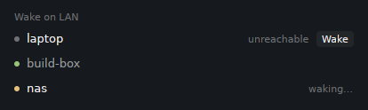

# wake-on-lan



A [Herdr](https://herdr.dev) mod that wakes a sleeping remote machine with a
Wake-on-LAN magic packet, so its spaces and agents come back.

When a machine of `hc machine ls` goes to sleep, its ssh connection drops and
its agents can't be reached. This mod notices, offers to wake it, and sends
the magic packet for you.

## What it does

- A **Wake on LAN** list under the Spaces list shows your remote machines:
  a dot (green when connected), the name, its state, and a **Wake** button
  when it doesn't answer.
- When a machine you were connected to stops answering, a **toast** offers
  to wake it.
- **Wake** sends magic packets to your network's broadcast addresses, again
  every 20 s, until the machine is connected again (a "is back" toast) or
  2 min have passed (a toast saying it didn't wake up).
- The MAC address is **learned by itself**: while a machine is connected,
  the mod reads it from this computer's neighbour (ARP) table. Nothing to set
  up when it is right.

Nothing is sent without a click: a machine you put to sleep on purpose stays
asleep.

## Requirements

- **Same network** (v1): the magic packet is a local broadcast. It doesn't
  cross a router or a VPN; a machine reached that way isn't learned
  ("not on this network").
- `python3` on this computer (standard library only), and `ip` (Linux) or
  `arp` (macOS) to read the neighbour table.
- The sleeping machine must allow it:
  - Wake-on-LAN on in its firmware (BIOS/UEFI), for waking from sleep, not
    only from power off;
  - on its network card: on Linux `sudo ethtool <iface> | grep Wake-on` should
    say `g`; turn it on with `sudo ethtool -s <iface> wol g` and make it stick
    (NetworkManager: `nmcli connection modify <conn> 802-3-ethernet.wake-on-lan magic`);
  - **Ethernet**, in practice: most laptops can't be woken over Wi-Fi.

### "random MAC"

A row marked **random MAC** learned a locally administered address: a
randomised one, typical of Wi-Fi privacy settings. A magic packet must carry
the network card's own address. Give it at install:

```sh
./install.sh --mac <machine>=aa:bb:cc:dd:ee:ff
```

(`<machine>` as named in `hc machine ls`; on the machine, `ip link` shows each
card's own address, `permaddr` when it differs).

## Install

Needs the Herdr app running.

```sh
git clone <this repo> && cd herdr-wake-on-lan
./install.sh                 # the layout shown now
./install.sh main            # or a given layout
./install.sh --mac nas=00:00:5e:00:53:10
./install.sh --headless      # no list: another mod shows the Wake buttons
./install.sh --list          # the list again
```

The script copies the mod to `~/.config/herdr-app/mods/wake-on-lan` and adds
the list under the Spaces list. Herdr's own layouts are read-only, so a
shipped one (`main`; `terminals` and `win98` have no Spaces list, so the
script refuses them) is first duplicated as
`<name>-wol`. Backups go to `~/.config/herdr-app/.wake-on-lan-backup/`.

Without the script: copy `mods/wake-on-lan` into `~/.config/herdr-app/mods/`
and add this block to a layout, for example after the `spaces` block:

```json
{ "id": "wake-on-lan", "type": "block", "size": { "px": 68 }, "content": { "mod": "wake-on-lan" } }
```

Block props: `"macs": { "<machine>": "<mac>" }` replaces learned addresses;
`"demo": true` shows sample rows and does nothing; `"headless": true` draws
nothing (give the block `"size": { "px": 0 }`). The block sizes itself to its
rows.

### Wake buttons in another mod

With `--headless`, the list goes and the mod keeps running, for another mod
that shows a Wake button where your machines already are. Don't hide the block instead (`"hidden": true`): a hidden copy never
starts. The contract, in shared state:

- `wake-on-lan.status`: `{ at, machines: { <machine id>: { name, mac, random, away } } }`
  (`away`: this computer is on another network than where the MAC was
  learned; don't offer Wake then),
  rewritten every 10 s while the mod runs (older than 35 s: it doesn't).
- `wake-on-lan.waking`: `{ <machine id>: { since, by, beat } }` while a
  machine is being woken (2 min at most; `beat` is rewritten every 3 s, an
  entry not rewritten for 45 s was cut off).
- `wake-on-lan.request`: write `{ <machine id>: Date.now() }` (merged with
  what is there) to ask for a wake, the same as a click; taken within a
  second, ignored after 30 s.

## Uninstall

```sh
./uninstall.sh          # --help shows what it does, without doing it
```

Run it with the Herdr app closed to also remove the learned addresses from
`shared.json`. Each layout it changes is backed up first to
`~/.config/herdr-app/.wake-on-lan-backup/<date>-uninstall/`.

## How it works

- Every 10 s, `hc machine ls --json` gives each machine's state. One copy of
  the mod (a leader, in shared state) does the learning and the toasts.
- `wol.py lookup <ssh target>` resolves the host (a `:port` dropped, `ssh -G`
  for aliases), checks it is on this network (no ProxyJump/ProxyCommand,
  `ip route get`: no gateway and an Ethernet-like link, not a VPN tunnel; the
  mod also skips machines with a `via`) and reads its MAC (`ip neigh`,
  else `arp -n`). A machine that can't be learned, or isn't connected, is looked up again
  every 5 min (every 30 s while this computer has no network yet). Learned addresses live in the shared key
  `wake-on-lan.machines`.
- `wol.py send <mac> [ip] [net]` sends the packet (6 × `ff` + 16 × the MAC)
  over UDP ports 9 and 7 to `255.255.255.255` and to the broadcast address of
  each local network holding the machine's last address (`ip`, or `ifconfig`
  on macOS). With `net` (the network the MAC was learned on) and this
  computer on another one, it sends nothing: the row turns "other network"
  and a toast says it can't be woken from here.
- The toast's button runs `wake-on-lan.wake-<machine id>`, a command of this
  mod (it only reaches a shown copy: once the block is hidden after it
  started, the toast has no button).
- Other mods ask for a wake through the shared key `wake-on-lan.request`
  (see [Wake buttons in another mod](#wake-buttons-in-another-mod)).

## Known limits

- A machine's MAC is remembered with the network it was learned on (that
  network's gateway). On another network (a café, a VPN), its row says
  "other network" and there is no Wake; back on the first one, Wake comes back.
  The network is recognised by its gateway: after a router change while the
  machine sleeps, or behind a range extender, it may wrongly say "other
  network". Then give its MAC (`./install.sh --mac <machine>=<mac>`): a
  machine with a MAC given that way is never "other network".

- Same network only (v1). A VPN, another network, or a relay machine on the
  sleeping machine's network are for a later version.
- Whether the machine wakes depends on it (firmware, card, Ethernet): the mod
  can only send the packet and wait.
- The toast's **Wake** button runs a command of this mod, which only reaches
  it while it is on screen. With the sidebar hidden (`ctrl-shift-b`), it does
  nothing: show the sidebar and use the Wake button there.
- Headless or not, the mod starts the first time its block shows: if Herdr
  starts with the sidebar hidden, nothing is learned, toasted or offered until
  the sidebar is shown once.
- Herdr reconnects by itself once the machine answers again; how soon depends
  on Herdr's own retry, not on this mod.

## License

[MIT](LICENSE)
